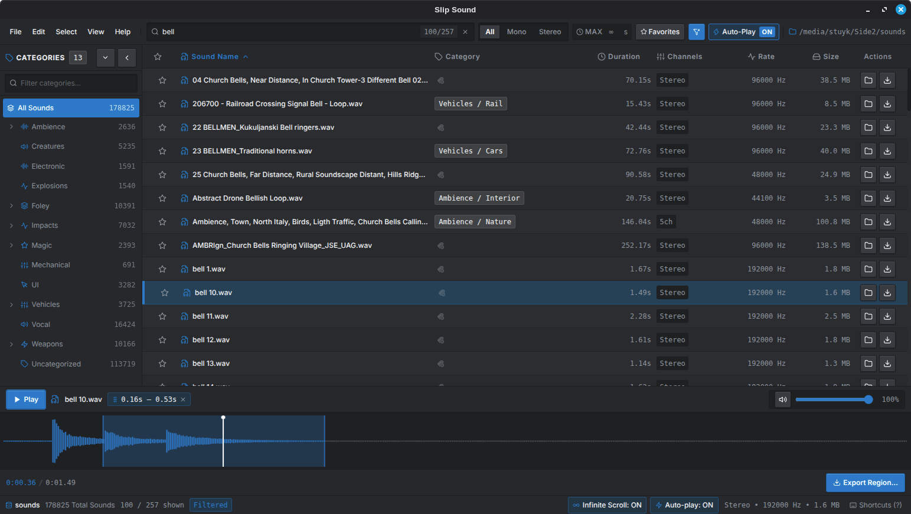
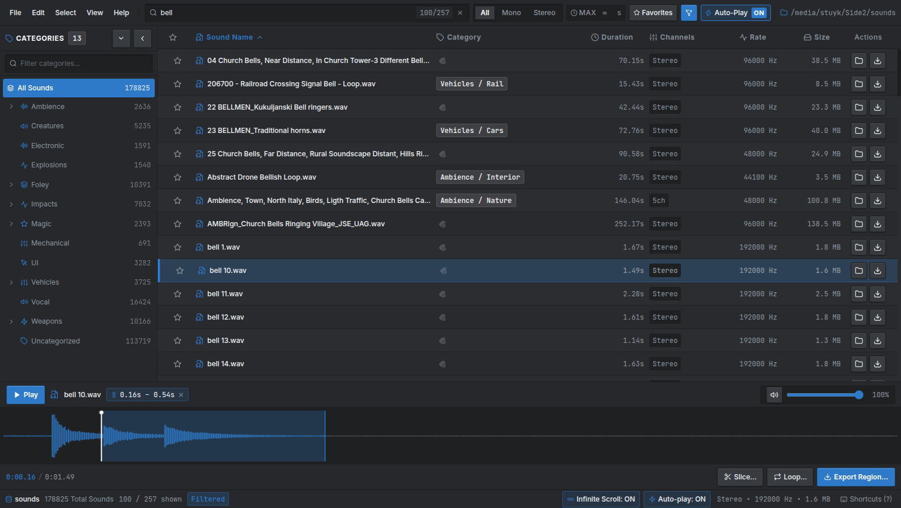
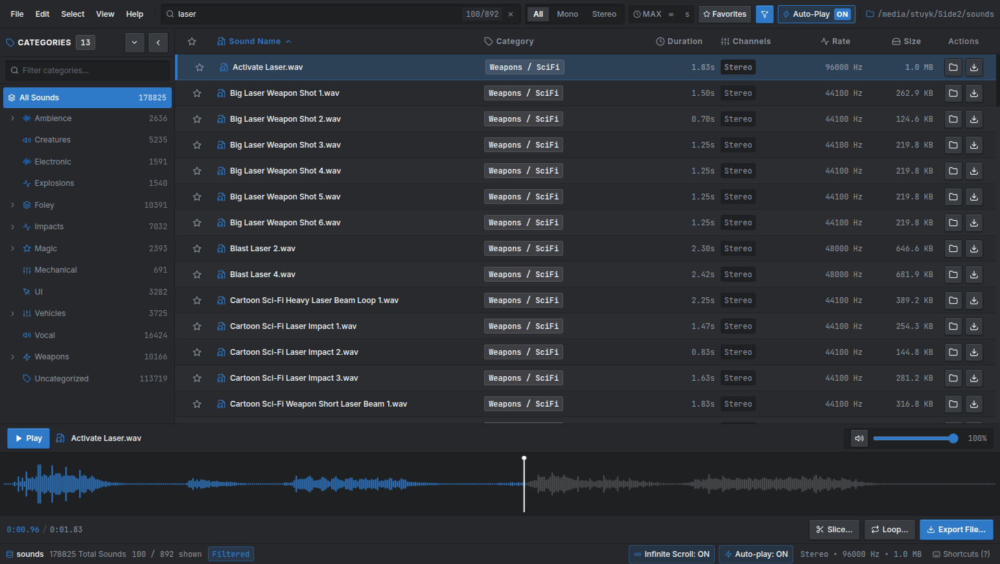
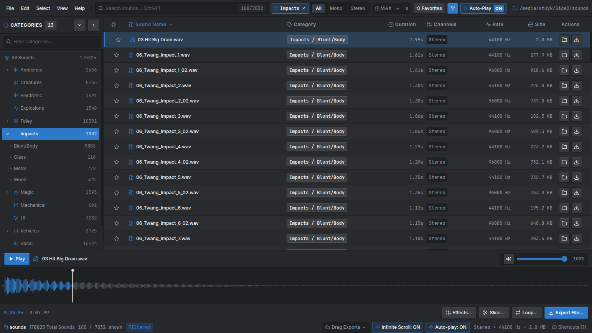
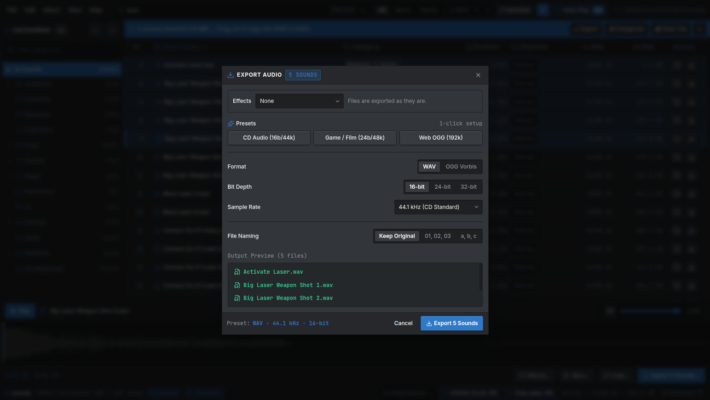
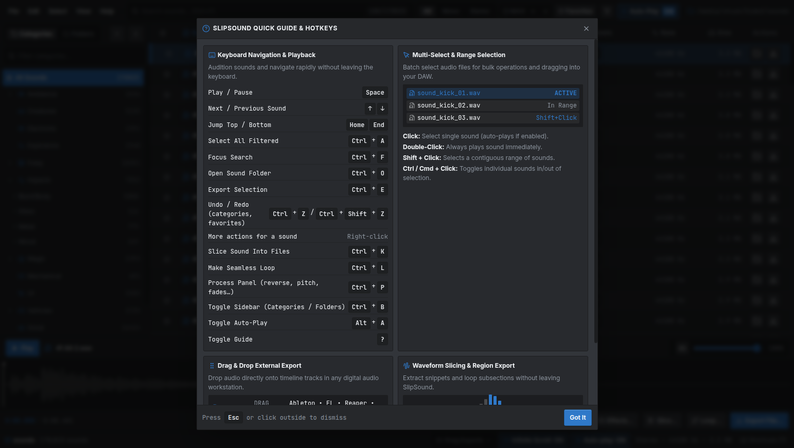
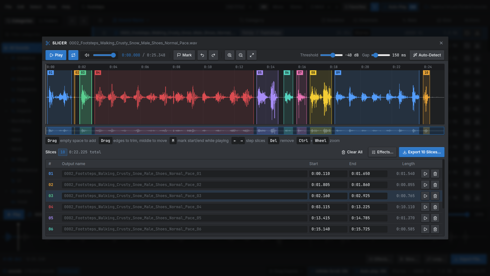
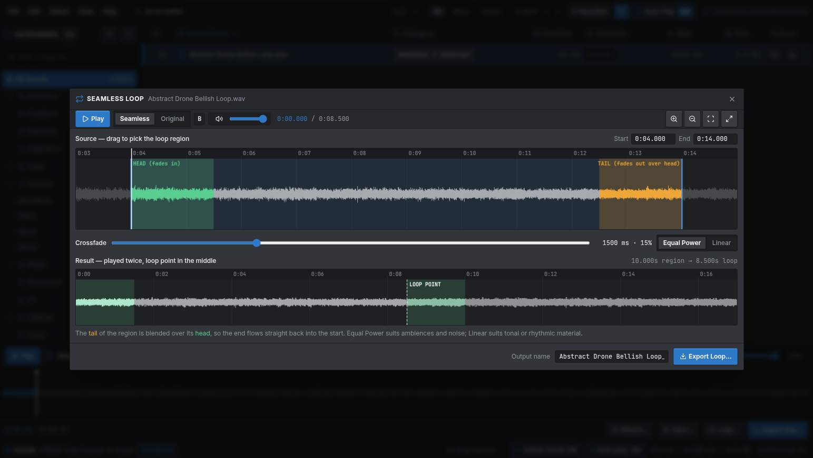
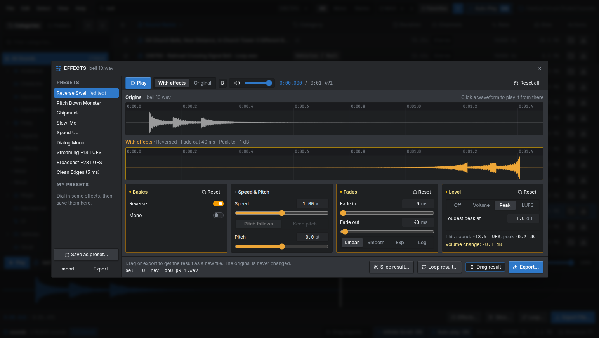

<p align="center">
  
</p>

<h1 align="center">Slip Sound</h1>

<p align="center">
  <strong>Fast, brain-dead simple desktop audio sample manager.</strong>
</p>

Most sample organizers are bloated nightmares or require cloud accounts and subscriptions just to search files on your own hard drive.

Slip Sound is fast, local, and free. No accounts, no subscriptions, and no file caps. Just your sounds.

<p align="center">
  <a href="https://github.com/Stuyk/slip-sound/releases">
    
  </a>
  <br />
  <sub><a href="https://stuyk.github.io/slip-sound/">Landing page</a></sub>
</p>

<p align="center">
  
</p>

## Core Philosophy

Every folder you open gets its own SQLite database, saved right at that folder's root. Index once, then just open it again later, instant. Reindex only when you've actually added or changed files. No central catalog, no hidden app-data blob, the index travels with the folder.

## Performance

- **170,000 files in ~2 minutes:** Recursive scan into local SQLite.
- **Sub-0.2s search:** Instant fuzzy filtering across hundreds of thousands of rows.
- **Near-instant playback:** Zero audio buffering lag.
- **100% offline:** No tracking, no web services.

## What It Does

- **Search & Auto-Categorize:** Filter by query, channels, duration, favorites, or category sidebar. Files get auto-tagged on index.
- **Manual Category Overrides:** Click a category to reassign or clear it. Sticks through reindexes.
- **Sortable Table:** Click any column header to sort.
- **Favorites:** Star sounds, filter to favorites only.
- **Waveform Preview:** Click-to-seek, auto-play toggle, drag to select and loop a region.
- **Region Export & Drag-Out:** Export just the selected region, or drag it straight into another app. Drag-outs are saved to a persistent folder, so they never go offline in your editor.
- **Slicer:** Cut one sound into many files. Drag out regions, tap `M` while it plays to mark start/end, or auto-detect sounds between silences, then export every slice in one go with its own name.
- **Seamless Loop:** Pick a region and crossfade its tail over its head so it repeats with no click or jump. A/B the result against the raw loop while you tweak the crossfade, then export it like any other sound.
- **Effects:** Reverse, pitch, speed, fades, mono, volume, and peak or LUFS normalize in their own window, with before/after waveforms. Drag or export the result as a new file; the original is never touched. Save your settings as presets.
- **DAW Drag & Drop:** Drag one file or a whole multi-selection into Reaper, Ableton, FL Studio, Godot, Unity, etc.
- **Batch Exporter:** WAV (16/24/32-bit) or OGG Vorbis, any sample rate, auto-numbered or lettered output names.
- **Reveal in Folder:** Jump to any file in your system file manager.
- **Remembers Where You Left Off:** Reopens your last library automatically.
- **Keyboard-Driven:** Full mouse-free navigation.
- **MCP Server (opt-in):** Let AI tools like Claude Desktop or Cursor search, tag, and export your library. Off by default, toggle it in Settings. See [MCP Server](#mcp-server).

<p align="center">
  
</p>
<p align="center">
  
</p>
<p align="center">
  
</p>
<p align="center">
  
</p>

## Quick Start

Requires [Bun](https://bun.sh).

```bash
bun install
bun run dev
```

Point it at a sample folder (`Ctrl+O`). It indexes automatically and caches locally.

## Keybindings

| Key | Action |
| --- | --- |
| `Space` | Play / Pause |
| `↑` / `↓` | Previous / Next sound |
| `Home` / `End` | Jump to top / bottom |
| `Double Click` | Play immediately |
| `Ctrl` + `Click` | Add/remove a sound from the multi-selection |
| `Ctrl` + `A` | Select all sounds matching the current filters |
| `Shift` + `Click` | Select every sound between the last click and this one |
| `Ctrl` + `F` | Focus search |
| `Ctrl` + `O` | Open folder |
| `Ctrl` + `B` | Toggle category sidebar |
| `Ctrl` + `E` | Export selection / region |
| `Ctrl` + `K` | Open the Slicer for the selected sound |
| `Ctrl` + `L` | Open the Seamless Loop tool for the selected sound |
| `Ctrl` + `P` | Open the Effects window for the selected sound(s) |
| `Alt` + `A` | Toggle auto-play |
| `?` | Interactive help guide |

<p align="center">
  
</p>

## Slicer

Got one file with a dozen hits, footsteps, or one-shots in it? Select it and hit `Ctrl+K` (or **Slice…** under the waveform) to cut it into separate files.

<p align="center">
  
</p>

- **Drag** across empty waveform to add a slice. Drag a slice's edges to trim it, or its middle to move it.
- **Tap `M`** while it plays to mark a slice start, then `M` again to mark the end. Mark by ear in real time.
- **Auto-Detect** finds every sound between silences. Tune the threshold (dB) and minimum gap (ms) if it splits too much or too little.
- Name each slice (or keep the default `<file>_01`, `<file>_02`, …), fine-tune start/end by typing exact times, then **Export** them all at once through the normal export dialog.

Slices stick around per file until you close the app.

| Key | Action |
| --- | --- |
| `Space` | Play / stop (loops the selected slice) |
| `M` | Mark slice start / end |
| `←` / `→` | Step through slices |
| `Del` | Remove selected slice |
| `L` | Toggle looping |
| `Ctrl` + `Z` / `Ctrl` + `Shift` + `Z` | Undo / redo |
| `Ctrl` + `Wheel`, `+` / `-` / `0` | Zoom in / out / fit |
| `Ctrl` + `E` | Export slices |

## Seamless Loop

Turn any stretch of audio into a loop that repeats without a click. Select a sound (optionally drag a region first) and hit `Ctrl+L` (or **Loop…** under the waveform).

<p align="center">
  
</p>

Pick the loop region, then set the crossfade. The last part of the region (the tail) gets blended over the start (the head), so the end flows straight back into the beginning. The loop comes out shorter by the crossfade length. **Equal Power** works best for ambiences and noise, **Linear** for tonal or rhythmic stuff.

The result view shows the loop played twice with the loop point marked, so you can see the seam. Hit `B` while it plays to flip between the seamless version and the raw region and hear the difference. Export goes through the normal export dialog, so any format, sample rate, or bit depth works.

| Key | Action |
| --- | --- |
| `Space` | Play / stop the loop |
| `B` | A/B: seamless vs. original |
| `Ctrl` + `Wheel`, `+` / `-` / `0` | Zoom in / out / fit |
| `Ctrl` + `E` | Export loop |

## Effects

Quick fixes before a sound goes into your timeline, with no round trip through a DAW. Select a sound (or drag a region, or select several) and hit `Ctrl+P` (or **Effects…** under the waveform).

<p align="center">
  
</p>

- **Pick a preset or change a setting.** The *With effects* waveform updates as you go, under the *Original*. Hit `Space` to play, `B` to flip between the two, or click either waveform to play it from that point.
- **Basics:** Reverse, Mono. **Speed & Pitch:** speed with pitch following (like tape) or kept, and pitch in semitones that keeps the length. **Fades:** in/out with four shapes. **Level:** change volume, normalize the peak, or normalize loudness (LUFS, with presets for streaming −14, podcast −16 and broadcast −23) under a peak ceiling. The readout shows the sound's loudness and how much the volume will change.
- **Get the result:** drag it straight into your editor, or **Export…** for any format. With several sounds selected, both apply the effects to all of them; step through the previews with `←` / `→`.
- **Presets:** built-ins like *Reverse Swell*, *Pitch Down Monster* and *Streaming −14 LUFS*, plus your own. Save, update, and import/export them as JSON to share with your team.
- **In the Export dialog,** the **Effects** picker can apply any preset to a batch, Slicer slices, or a Seamless Loop (minus fades, which would break the loop). It's set to None unless you came from the Effects window, so nothing gets processed by surprise.
- **Names:** processed files get a suffix so you can tell them apart: `door_slam__rev_p-3_fo200.wav`.

### Drag Exports

Anything you drag out that isn't the original file (a region, an Effects result) is saved to **`~/Slip Sound/Drag Exports`**, not a temp folder, so DaVinci Resolve, Premiere and friends never show it as offline. The **Drag Exports** button in the status bar lists recent drags and lets you open or change the folder, pick 16/24/32-bit WAV (24-bit by default), or clear it (to the trash).

## MCP Server

Slip Sound can run a local [Model Context Protocol](https://modelcontextprotocol.io) server so AI tools (Claude Desktop, Cursor, VS Code, etc.) can search, tag, and export your library directly. Off by default. Turn it on from **Settings** (gear icon, top right), where you can also copy the connection URL and bearer token.

Bound to `127.0.0.1` only, with a random bearer token minted per launch and Origin/Host validation to block browser-based DNS-rebinding probes. Connection details (URL + token, ready to paste into an `mcpServers` config block) are also written to `mcp-connection.json` in the app's user data folder while it's running.

**Tools exposed:**

| Tool | What it does |
| --- | --- |
| `search_sounds` | Filter by filename, category, subcategory, channels, duration, favorite status |
| `list_uncategorized_sounds` | Page through sounds still tagged "Uncategorized," for an agent to work through and tag |
| `get_sound` | Full metadata for one file by path |
| `get_categories` | Category/subcategory facet counts |
| `open_library` | Open or switch to a folder |
| `get_recent_libraries` | Recently opened folders |
| `get_library_status` | Currently open folder + sound count |
| `set_category` / `clear_category` | Manually tag or untag a sound |
| `toggle_favorite` | Star / unstar a sound |
| `export_sound` | Export (optionally trimmed and processed: reverse, speed, pitch, mono, fades, gain, peak/LUFS normalize) to WAV/OGG at any sample rate |
| `reveal_in_folder` | Open the file's location in the system file manager |
| `reindex_library` | Rescan the open folder for new/changed/removed files |

## Releases

Every GitHub release ships a `SHA256SUMS-linux.txt` / `SHA256SUMS-mac.txt` / `SHA256SUMS-windows.txt` alongside the binaries. Verify a download with:

```bash
sha256sum -c SHA256SUMS-linux.txt   # Linux
shasum -a 256 -c SHA256SUMS-mac.txt   # macOS
certutil -hashfile slip-sound-Setup.exe SHA256   # Windows, compare against the .txt
```

Releases are driven entirely by `package.json`'s `version` field, no manual tagging. Every push to `main` builds and checks whether `vX.Y.Z` already has a GitHub release; if not, it creates the tag and a draft release automatically. Bump the version to cut a new release.

## Building

```bash
bun run build:linux  # AppImage, deb, tar.gz
bun run build:win    # NSIS installer, portable exe
bun run build:mac    # dmg, zip
bun run build:all    # Both
```

## Stack

Electron 39, Node 22 (`node:sqlite`), SolidJS, Tailwind CSS v4, electron-vite, ffmpeg-static, `@modelcontextprotocol/sdk`, Bun.

## Alternative To

A free, fast, local alternative to sample managers like Soundly, BaseHead, Soundminer, Resonic, AudioFinder, Sononym, and ADSR Sample Manager.

## License

GPL-3.0-or-later. See [LICENSE](LICENSE). Required by the bundled `ffmpeg-static` binary, which is built with `--enable-gpl`.
