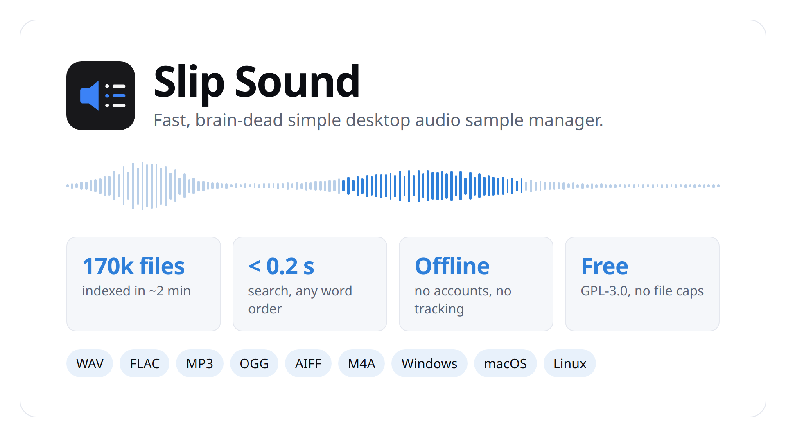
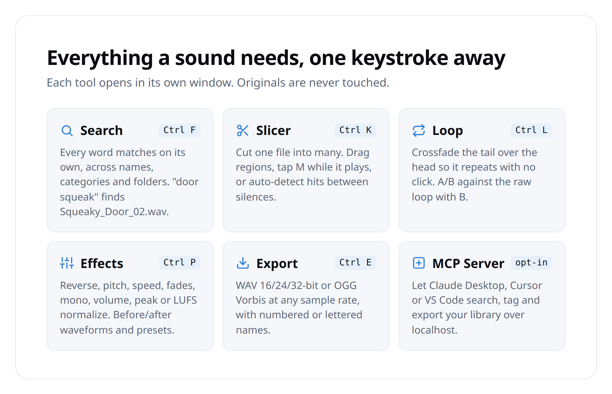
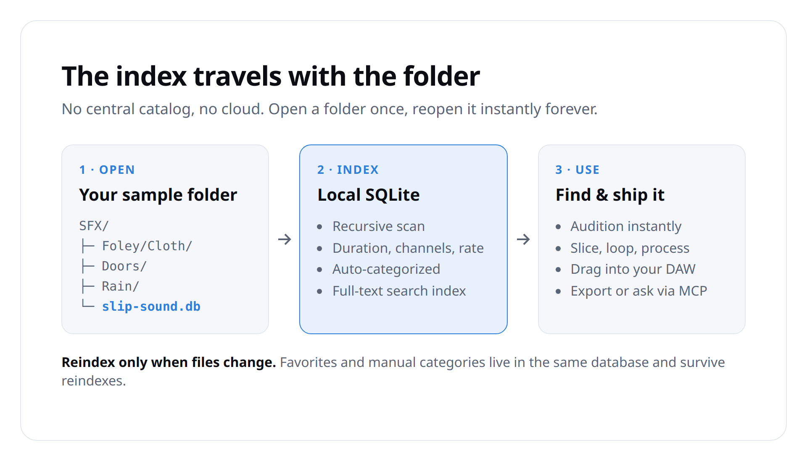
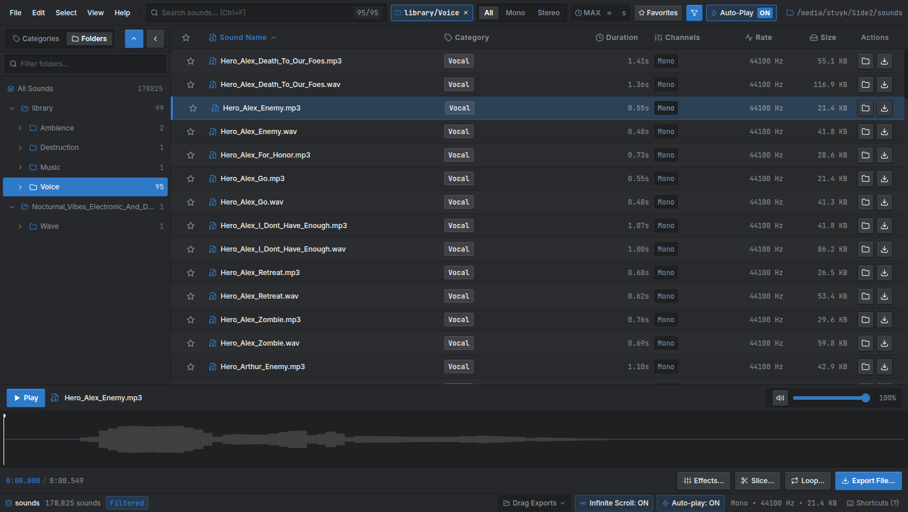

<!-- hypedoc:start -->
<!-- Generated by HypeDoc. Edit the .html sources and run `hypedoc build`; changes inside this block are overwritten. -->
<p align="center">
  <picture>
    <source media="(prefers-color-scheme: dark)" srcset=".hypedoc/img/01-hero.dark.png">
    <source media="(prefers-color-scheme: light)" srcset=".hypedoc/img/01-hero.light.png">
    
  </picture>
</p>
<p align="center">
  <picture>
    <source media="(prefers-color-scheme: dark)" srcset=".hypedoc/img/02-tools.dark.png">
    <source media="(prefers-color-scheme: light)" srcset=".hypedoc/img/02-tools.light.png">
    
  </picture>
</p>
<p align="center">
  <picture>
    <source media="(prefers-color-scheme: dark)" srcset=".hypedoc/img/03-how-it-works.dark.png">
    <source media="(prefers-color-scheme: light)" srcset=".hypedoc/img/03-how-it-works.light.png">
    
  </picture>
</p>
<!-- hypedoc:end -->

<p align="center">
  <a href="https://github.com/Stuyk/slip-sound/releases">
    
  </a>
  <br />
  <sub><a href="https://stuyk.github.io/slip-sound/">Landing page</a> · <a href="CHANGELOG.md">Changelog</a> · <a href="#keyboard-shortcuts">Shortcuts</a> · <a href="#mcp-server">MCP Server</a></sub>
</p>

Most sample organizers are bloated, or want a cloud account and a subscription just to search files on your own hard drive.

Slip Sound is fast, local, and free. No accounts, no subscriptions, no file caps. Point it at a folder of sounds, find what you need, and drag it into your editor.

<p align="center">
  
</p>

## Contents

- [Getting Started](#getting-started)
- [How It Works](#how-it-works)
- [Features](#features)
- [Slicer](#slicer)
- [Seamless Loop](#seamless-loop)
- [Effects](#effects)
- [Keyboard Shortcuts](#keyboard-shortcuts)
- [MCP Server](#mcp-server)
- [Development](#development)
- [Releases](#releases)
- [License](#license)

## Getting Started

1. Download the latest build for your platform from [Releases](https://github.com/Stuyk/slip-sound/releases):
   - **Windows:** NSIS installer or portable `.exe`
   - **macOS:** `.dmg` or `.zip`
   - **Linux:** AppImage, `.deb`, or `.tar.gz`
2. Open a sample folder with `Ctrl+O`. Slip Sound scans it and builds an index.
3. Search, audition with `Space`, and drag sounds into your DAW, game engine, or video editor.

Next time you launch, your last library reopens on its own.

**Supported formats:** WAV, FLAC, MP3, OGG, AIFF/AIF, M4A.

## How It Works

Every folder you open gets its own SQLite database (`slip-sound.db`) saved at that folder's root. Index once, and reopening is instant. Reindex only when you've added or changed files. There's no central catalog and no hidden app-data blob: the index travels with the folder.

The index holds each file's duration, channels and sample rate, an auto-assigned category, and a full-text search index. Your favorites and manual category changes live in the same database and survive reindexes.

| | |
| --- | --- |
| **Indexing** | ~170,000 files in about 2 minutes |
| **Search** | Under 0.2 s across hundreds of thousands of rows |
| **Playback** | Starts immediately, no buffering |
| **Network** | None. No tracking, no web services |

## Features

### Find

- **Search:** Every word matches on its own, in any order, across file names, categories and folder names. "door squeak" finds `Squeaky_Door_02.wav`. Accents are ignored, and words inside names joined by `_`, `-` or `.` are found too.
- **Filters:** Narrow by channels, duration, favorites, or the sidebar.
- **Categories:** Files are auto-tagged when indexed (you can turn this off in Settings). Click a category to reassign or clear it; manual choices stick through reindexes.
- **Folders view:** Switch the sidebar to **Folders** to browse your real folder tree, expand and collapse subfolders, and search inside the folder you pick.
- **Favorites:** Star sounds and filter to favorites only.
- **Sortable table:** Click any column header to sort.

<p align="center">
  
</p>
<p align="center">
  
</p>

### Audition

- **Waveform preview:** Click to seek, toggle auto-play, drag to select and loop a region.
- **Right-click menu:** Every action for a sound, or the whole selection, in one place: play, effects, slice, loop, export, reveal, show in folders, copy path, favorite, categorize.
- **Undo / redo:** `Ctrl+Z` takes back category changes and favorites, bulk edits included.
- **Keyboard-driven:** Everything works without a mouse. Press `?` for the interactive guide.

<p align="center">
  
</p>

### Get it out

- **Drag and drop:** Drag one file or a whole multi-selection into Reaper, Ableton, FL Studio, Godot, Unity, and so on.
- **Region export and drag-out:** Export just the selected region, or drag it straight into another app.
- **Batch exporter:** WAV (16/24/32-bit) or OGG Vorbis, any sample rate, auto-numbered or lettered output names. An optional Effects preset can be applied to the whole batch.
- **Reveal in folder:** Jump to any file in your system file manager.

<p align="center">
  
</p>

#### Drag Exports

Anything you drag out that isn't the original file (a region, an Effects result) is saved to **`~/Slip Sound/Drag Exports`**, not a temp folder, so DaVinci Resolve, Premiere and friends never show it as offline. The **Drag Exports** button in the status bar lists recent drags and lets you open or change the folder, pick 16/24/32-bit WAV (24-bit by default), or clear it (to the trash). The same options are in **Settings**, and the first drag of each session tells you where the copy went.

## Slicer

Got one file with a dozen hits, footsteps, or one-shots in it? Select it and press `Ctrl+K` (or **Slice…** under the waveform) to cut it into separate files.

<p align="center">
  
</p>

- **Drag** across empty waveform to add a slice. Drag a slice's edges to trim it, or its middle to move it.
- **Tap `M`** while it plays to mark a slice start, then `M` again to mark the end.
- **Auto-Detect** finds every sound between silences. Tune the threshold (dB) and minimum gap (ms) if it splits too much or too little.
- **Name** each slice (or keep the default `<file>_01`, `<file>_02`, …), type exact start/end times if needed, then **Export** them all through the normal export dialog.

Slices are kept per file until you close the app. **Effects…** sends every slice to the Effects window so you can process them all at once and keep their slice names.

| Key | Action |
| --- | --- |
| `Space` | Play / stop (loops the selected slice) |
| `M` | Mark slice start / end |
| `←` / `→` | Step through slices |
| `Del` | Remove selected slice |
| `L` | Toggle looping |
| `Ctrl` + `Z` / `Ctrl` + `Shift` + `Z` | Undo / redo |
| `Ctrl` + `Wheel`, `+` / `-` / `0` | Zoom in / out / fit |
| `Ctrl` + `E` | Export slices |

## Seamless Loop

Turn any stretch of audio into a loop that repeats without a click. Select a sound (optionally drag a region first) and press `Ctrl+L` (or **Loop…** under the waveform).

<p align="center">
  
</p>

Pick the loop region, then set the crossfade. The end of the region (the tail) is blended over its start (the head), so the end flows straight back into the beginning. The loop comes out shorter by the crossfade length. **Equal Power** works best for ambiences and noise, **Linear** for tonal or rhythmic material.

The result view plays the loop twice with the loop point marked, so you can see the seam. Press `B` while it plays to flip between the seamless version and the raw region. Export uses the normal export dialog, so any format, sample rate, or bit depth works. **Effects…** opens the finished loop in the Effects window (fades are skipped so it stays seamless).

| Key | Action |
| --- | --- |
| `Space` | Play / stop the loop |
| `B` | A/B: seamless vs. original |
| `Ctrl` + `Wheel`, `+` / `-` / `0` | Zoom in / out / fit |
| `Ctrl` + `E` | Export loop |

## Effects

Quick fixes before a sound goes into your timeline, with no round trip through a DAW. Select a sound (or drag a region, or select several) and press `Ctrl+P` (or **Effects…** under the waveform).

<p align="center">
  
</p>

| Group | Controls |
| --- | --- |
| **Basics** | Reverse, Mono |
| **Speed & Pitch** | Speed with pitch following (like tape) or kept; pitch in semitones that keeps the length |
| **Fades** | Fade in / out with four shapes |
| **Level** | Change volume, normalize peak, or normalize loudness (LUFS presets: streaming −14, podcast −16, broadcast −23) under a peak ceiling |

- **Preview:** The *With effects* waveform updates as you go, under the *Original*. Press `Space` to play, `B` to flip between the two, or click either waveform to play from that point.
- **Get the result:** Drag it straight into your editor, or **Export…** for any format. With several sounds selected, both apply the effects to all of them; step through the previews with `←` / `→`.
- **Presets:** Built-ins like *Reverse Swell*, *Pitch Down Monster* and *Streaming −14 LUFS*, plus your own. Save, update, and import/export them as JSON to share with your team.
- **File names:** Processed files get a suffix describing the effects, e.g. `door_slam__rev_p-3_fo200.wav`. Originals are never changed.
- **Keep going:** **Slice result…** and **Loop result…** open the processed sound in the Slicer or Seamless Loop tool.

## Keyboard Shortcuts

| Key | Action |
| --- | --- |
| `Space` | Play / pause |
| `↑` / `↓` | Previous / next sound |
| `Home` / `End` | Jump to top / bottom |
| Double-click | Play immediately |
| `Ctrl` + click | Add / remove a sound from the selection |
| `Shift` + click | Select everything between the last click and this one |
| `Ctrl` + `A` | Select all sounds matching the current filters |
| `Ctrl` + `F` | Focus search |
| `Ctrl` + `Z` / `Ctrl` + `Shift` + `Z` | Undo / redo category and favorite changes |
| Right-click | All actions for the sound or selection |
| `Ctrl` + `O` | Open folder |
| `Ctrl` + `B` | Toggle the sidebar (Categories / Folders) |
| `Ctrl` + `E` | Export selection / region |
| `Ctrl` + `K` | Slicer |
| `Ctrl` + `L` | Seamless Loop |
| `Ctrl` + `P` | Effects |
| `Alt` + `A` | Toggle auto-play |
| `?` | Interactive help guide |

<p align="center">
  
</p>

## MCP Server

Slip Sound can run a local [Model Context Protocol](https://modelcontextprotocol.io) server so AI tools (Claude Desktop, Cursor, VS Code, etc.) can search, tag, and export your library. It's **off by default**. Turn it on in **Settings** (gear icon, top right), where you can also copy the connection URL and bearer token.

**Security:** The server binds to `127.0.0.1` only, uses a random bearer token minted each launch, and validates Origin/Host headers to block browser-based DNS-rebinding probes. While it runs, the connection details (URL and token, ready to paste into an `mcpServers` config block) are written to `mcp-connection.json` in the app's user data folder.

| Tool | What it does |
| --- | --- |
| `search_sounds` | Filter by filename, category, subcategory, folder, channels, duration, favorite status |
| `list_uncategorized_sounds` | Page through sounds still tagged "Uncategorized" so an agent can tag them |
| `get_sound` | Full metadata for one file by path |
| `get_categories` | Category / subcategory facet counts |
| `open_library` | Open or switch to a folder |
| `get_recent_libraries` | Recently opened folders |
| `get_library_status` | Currently open folder and sound count |
| `set_category` / `clear_category` | Tag or untag a sound |
| `toggle_favorite` | Star / unstar a sound |
| `export_sound` | Export (optionally trimmed and processed: reverse, speed, pitch, mono, fades, gain, peak/LUFS normalize) to WAV/OGG at any sample rate |
| `reveal_in_folder` | Open the file's location in the system file manager |
| `reindex_library` | Rescan the open folder for new, changed, or removed files |

## Development

Requires [Bun](https://bun.sh) and Node 22.

```bash
bun install
bun run dev        # run the app with hot reload
bun run test       # vitest (processing tests use the bundled ffmpeg)
bun run typecheck  # main + renderer
bun run lint
```

Build installers:

```bash
bun run build:linux  # AppImage, deb, tar.gz
bun run build:win    # NSIS installer, portable exe
bun run build:mac    # dmg, zip
bun run build:all    # Windows + Linux
```

### Project layout

| Path | What's there |
| --- | --- |
| `src/main/` | Electron main process: indexer, SQLite (`db.ts`), classifier, peaks, ffmpeg export/processing, MCP server |
| `src/preload/` | IPC bridge exposed to the renderer |
| `src/renderer/` | SolidJS UI: workstation, tool windows (Slicer, Seamless Loop, Effects, Export), shared UI components |
| `docs/` | GitHub Pages landing page |
| `.hypedoc/` | Sources for the README graphics (rebuild with `hypedoc build --doc README.md`) |

**Stack:** Electron 39, Node 22 (`node:sqlite`), SolidJS, Tailwind CSS v4, electron-vite, ffmpeg-static, `@modelcontextprotocol/sdk`, Bun.

## Releases

Releases are driven by the `version` field in `package.json`; there's no manual tagging. Every push to `main` builds and checks whether `vX.Y.Z` already has a GitHub release. If not, CI creates the tag and a draft release. Bump the version to cut a new one.

Each release ships `SHA256SUMS-linux.txt`, `SHA256SUMS-mac.txt` and `SHA256SUMS-windows.txt` alongside the binaries. Verify a download with:

```bash
sha256sum -c SHA256SUMS-linux.txt                # Linux
shasum -a 256 -c SHA256SUMS-mac.txt              # macOS
certutil -hashfile slip-sound-Setup.exe SHA256   # Windows, compare against the .txt
```

## Alternative To

A free, fast, local alternative to sample managers like Soundly, BaseHead, Soundminer, Resonic, AudioFinder, Sononym, and ADSR Sample Manager.

## License

GPL-3.0-or-later. See [LICENSE](LICENSE). Required by the bundled `ffmpeg-static` binary, which is built with `--enable-gpl`.
